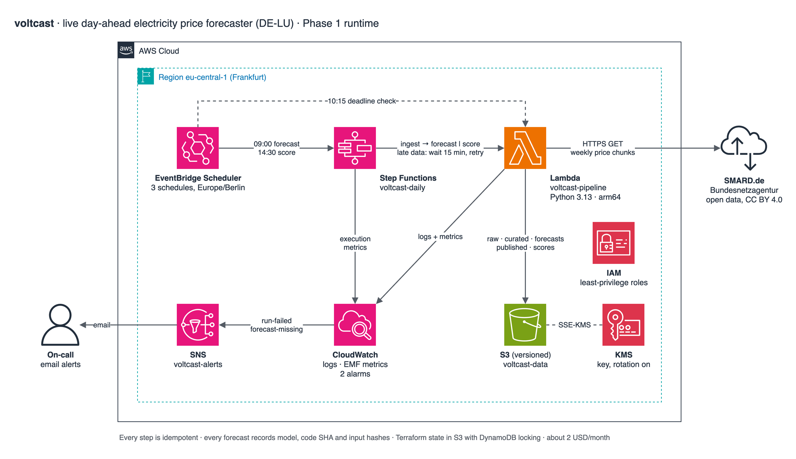

# voltcast

**Live day-ahead electricity price forecasts for Germany/Luxembourg, run as a service on AWS.**

Every morning voltcast forecasts tomorrow's electricity price for each of the
96 quarter-hours of the German/Luxembourg day-ahead auction. It publishes the
forecast before the auction closes at 12:00. That afternoon it grades itself
against the cleared prices. It runs unattended on AWS, raises an alert when it
misses a promise, and keeps the evidence behind every number it publishes.

**[Live status page](https://dhamsey3.github.io/voltcast/)**: the latest forecast
against the cleared price, the running error, what's deployed and the AWS bill.
It's rebuilt from the service's own records whenever a run finishes, and the data behind it
is at [`status.json`](https://dhamsey3.github.io/voltcast/status.json).

## Why this problem

The day-ahead auction sets the price of every 15-minute slot of the next day.
Prices swing widely within a day: the first live forecast (16 Oct 2026) ranges
from 89 to 270 EUR/MWh. Over the last year, 5.6% of slots cleared below zero.
Factories, battery operators, EV fleets and households on dynamic tariffs move
consumption to cheap slots, and traders bid on these forecasts.

The data is open ([SMARD](https://www.smard.de), Bundesnetzagentur), and the
true answer arrives every day. The model is graded daily, not once in a
notebook.

## What it promises

| Promise | Target | Enforced by |
|---|---|---|
| Tomorrow's forecast is published | by 10:15 Berlin, daily | deadline check → `forecast-missing` alarm |
| Every forecast is scored | same afternoon | `run-failed` alarm if scoring gives up |
| Bad upstream data is never used | always | [data contract](docs/adr/0005-data-contract.md) stops the run |
| No hindsight forecasts | always | live forecasts after the 12:00 gate closure are refused |
| Cost | about 1 USD/month, alert above 5 | AWS Budget `voltcast-monthly` emails on-call on actual or forecast spend |

## Architecture



Source: [`docs/architecture.drawio`](docs/architecture.drawio), drawn with draw.io's
AWS icon set. After editing it, run `make diagram` to re-export the image.

### How a day runs (Berlin time)

| Time | What happens |
|---|---|
| 09:00 | Scheduler starts a Step Functions run. Lambda pulls the latest prices from SMARD, checks them against the data contract, and saves a raw snapshot plus curated days to S3. It then forecasts the next open auction with the champion and every challenger, and publishes the champion. If upstream data is late, the run waits 15 minutes, re-ingests and retries. |
| 10:15 | Deadline check: if tomorrow's forecast isn't published, the `forecast-missing` alarm emails on-call. |
| 12:00 | The auction closes. Live forecasts for that day are refused from now on. |
| ~14:00 | Cleared prices appear on SMARD. |
| 14:30 | A second run ingests the cleared prices and scores every model's forecast. Error metrics go to CloudWatch. |

Why it's built this way, rather than with a SageMaker endpoint and Model
Monitor, is covered in [ADR 2](docs/adr/0002-daily-batch-not-endpoint.md) and
[ADR 4](docs/adr/0004-serverless-orchestration.md).

## Models: champion and challengers

Every model runs every day. The **champion's** forecast is published; the
**challengers** run in shadow and are scored the same way. Phase 1 has no
machine learning on purpose: these baselines are the bar any learned model has
to clear ([ADR 3](docs/adr/0003-naive-models-first.md)).

Replay over every day since the auction moved to 15-minute products
(2025-10-01 to 2026-10-15, 380 days):

| Model | Rule | MAE (EUR/MWh) | RMSE |
|---|---|---|---|
| **`naive_1d`** (champion) | same slot, most recent published day | **30.75** | **40.66** |
| `seasonal_naive_7d` | same slot, same weekday last week | 38.58 | 49.34 |

Promoting a model means a reviewed PR that changes the `champion` Terraform
variable, with `voltcast report` output as the evidence.

## Lineage

Every forecast records its model and version, the git SHA of the code, the
time it was made, and the S3 key and sha256 of every input day it read. The
bucket is versioned, so a source revision never silently overwrites history.
Any published number can be traced back to the exact bytes it came from.

## Repository

```text
src/voltcast/
  calendar.py   Berlin delivery days, 92/96/100 slots, gate closure
  smard.py      SMARD client (weekly chunks, no API key)
  contract.py   the data contract: missing waits, wrong stops
  models.py     champion/challenger models
  pipeline.py   ingest, forecast, score, check, backfill, report
  handler.py    Lambda entry point
  status.py     the status page's data: live record, promise, bill
  page.py       the status page itself: one self-contained HTML file
  trigger.py    asks GitHub to rebuild the status page when a run finishes
  __main__.py   CLI for local runs, backfills and the status page
tests/          59 tests, incl. both clock-change days and a real SMARD chunk
infrastructure/ Terraform: S3+KMS, Lambda, Step Functions, Scheduler, EventBridge, alarms, budget
docs/
  architecture.drawio  the diagram above (draw.io source)
  adr/          why things are the way they are
  runbook.md    what to do when an alarm fires
  incidents/    write-ups of every missed promise
```

## Run it locally

```bash
make setup      # Python 3.13 venv + dev tools
make test       # unit tests
make backfill   # replay every day since 2025-10-01 from real SMARD data (~30 s)
make report     # champion vs challenger
.venv/bin/python -m voltcast forecast   # forecast the next open auction
.venv/bin/python -m voltcast status     # build the status page into ./site from live results
```

State goes to `./data` (gitignored), laid out exactly as in the S3 bucket.

## Deploy

Merging to `main` deploys. The [deploy workflow](.github/workflows/deploy.yml)
runs `make plan` on every pull request that touches the code or the
infrastructure, and puts the plan in the run summary. On `main` it plans
again and applies, stamping the Lambda with the merge commit's SHA. AWS
access is GitHub OIDC with no stored keys. Pull requests get a read-only
plan role, and only `main` can assume the apply role. Both roles live in
`aws-oidc-bootstrap`, scoped to voltcast's own resources.

The workflow reads the role ARNs, region, state bucket and lock table from
repository variables, and the alert address from the `ALERT_EMAIL` secret.
It refuses to run without that secret, because an empty address would
delete the alert subscription.

### By hand

Prerequisites: the shared Terraform state bucket and lock table from
`aws-oidc-bootstrap`, plus AWS credentials for the target account.

```bash
cp infrastructure/backend.hcl.example infrastructure/backend.hcl         # fill in the account ID
cp infrastructure/terraform.tfvars.example infrastructure/terraform.tfvars  # set alert_email
make plan       # builds the Lambda bundle, then terraform plan
make deploy     # applies the reviewed plan
```

Confirm the SNS subscription email. The first scheduled run is the next 09:00
Berlin.

## Operating it

- [Status page](https://dhamsey3.github.io/voltcast/): rebuilt by the
  [status workflow](.github/workflows/status.yml) whenever a daily run finishes, started from
  AWS, with a read-only role that sees only published results ([ADR 6](docs/adr/0006-status-page.md))
- [Runbook](docs/runbook.md): what each alarm means and what to do
- [Incidents](docs/incidents/README.md): every missed promise, written up
- [Decisions](docs/adr/): ADRs 1 to 6

## Roadmap

1. **Live baseline service.** Live since 2026-10-14 in eu-central-1; the first live forecast is for 16 Oct 2026.
2. **Deploy from CI, public status page.** GitHub Actions deploys through OIDC
   ([Deploy](#deploy)), and the [status page](https://dhamsey3.github.io/voltcast/) shows the
   latest forecast against the cleared price, the running error, the deployed model and the AWS bill.
3. **First learned model.** Features from ENTSO-E (load, wind and solar forecasts) and DWD
   weather. Trained on SageMaker and registered in the Model Registry with
   lineage. The approval gate: beat the champion over 30 days in shadow.
4. **Monitoring beyond accuracy.** Input drift, error by regime (negative-price
   and scarcity hours), and a retraining trigger.
5. **Second market.** Switzerland (CH) day-ahead prices.

## Limitations

- The baselines repeat recent prices. They will miss spikes and regime changes by design.
- The numbers above are a replay, not a live record. The live record started on 2026-10-14
  and is reported separately (`live_days`).
- One account, one region, one environment.

## Data

Day-ahead prices: Bundesnetzagentur | SMARD.de, licensed
[CC BY 4.0](https://creativecommons.org/licenses/by/4.0/).
